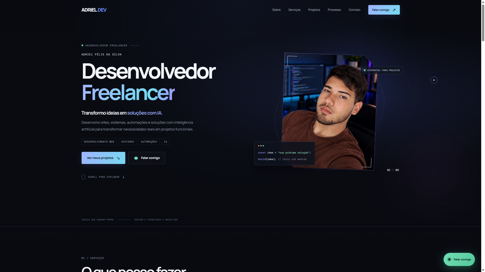

# ADRiEL.DEV — Portfólio profissional



> Portfólio profissional e site comercial de **Adriel Félix da Silva**, desenvolvido com **HTML5, CSS3 e JavaScript moderno**, com foco em experiência do usuário, responsividade e interação.

[](.)
[](.)
[](.)

## Sobre o projeto

Este projeto foi criado para apresentar serviços, projetos e processo de trabalho de forma visual e interativa. Além da apresentação profissional, o site possui uma experiência de **briefing interativo** que ajuda o visitante a organizar as necessidades do projeto antes de iniciar uma conversa pelo WhatsApp.

O projeto é **100% frontend**. Não possui backend, banco de dados ou dependências de runtime.

## ✨ Principais funcionalidades

- Interface responsiva para desktop e dispositivos móveis.
- Identidade visual própria com tema escuro, tipografia e microinterações.
- Navegação responsiva com menu mobile.
- Animações de entrada utilizando `IntersectionObserver`.
- Efeitos de cursor, parallax, iluminação e tilt quando suportados pelo dispositivo.
- Timeline visual do processo de desenvolvimento.
- Seção de apresentação profissional e projetos.
- Integração direta com WhatsApp e Instagram.
- Briefing interativo específico para cada serviço.
- Geração de mensagem de WhatsApp a partir das respostas do visitante.
- Navegação do briefing integrada à History API (`pushState` e `popstate`).
- Suporte a `prefers-reduced-motion` para reduzir animações quando solicitado pelo sistema.
- Recursos básicos de acessibilidade e navegação por teclado.

## 🧩 Briefing interativo

O site possui quatro fluxos de briefing:

- **Landing Page** — objetivo, identidade visual, conteúdo, WhatsApp, domínio e hospedagem.
- **Sistema Web** — usuários, autenticação, banco de dados e funcionalidades.
- **Automações & IA** — processos, ferramentas e objetivos de automação.
- **E-commerce** — produtos, catálogo, pagamentos, entrega, domínio e administração de pedidos.

O visitante responde às perguntas, revisa um resumo e pode abrir o WhatsApp com uma mensagem preenchida automaticamente.

**Importante:** nenhuma mensagem é enviada automaticamente. O WhatsApp apenas é aberto com o conteúdo preparado para que o visitante revise e decida se deseja enviar.

## 🛠️ Tecnologias

### Frontend

- HTML5 semântico
- CSS3
- JavaScript moderno com ES Modules
- DOM API
- Intersection Observer API
- History API
- `matchMedia`
- `prefers-reduced-motion`

### Práticas utilizadas

- Separação de responsabilidades entre módulos.
- Manipulação do DOM sem frameworks ou dependências externas.
- Uso de `textContent` para conteúdo dinâmico quando HTML não é necessário.
- Links externos com `rel="noopener noreferrer"` quando abertos em nova aba.
- Layout responsivo com CSS.
- Fallbacks para APIs do navegador.
- Respeito às preferências de movimento do usuário.

## 📁 Estrutura do projeto

```text
Meu-Portifolio/
├── .github/
│   └── workflows/
│       └── deploy-pages.yml
├── .gitignore
├── README.md
├── index.html
├── assets/
│   └── images/
│       ├── adriel-felix.jpeg
│       ├── favicon.png
│       ├── github-preview.png
│       └── mercearia-agape.png
├── css/
│   ├── style.css
│   ├── animations.css
│   └── briefing.css
└── js/
    ├── app.js
    ├── config.js
    ├── data/
    │   └── service-briefs.js
    ├── features/
    │   └── briefing.js
    └── ui/
        ├── interactions.js
        ├── links.js
        └── navigation.js
```

## 🧠 Organização da aplicação

### `index.html`

Estrutura semântica, conteúdo, metadados, navegação e pontos de integração da interface.

### `css/`

- `style.css` — estilos principais, componentes e responsividade.
- `animations.css` — animações e transições da interface principal.
- `briefing.css` — estilos específicos da experiência de briefing.

### `js/app.js`

Ponto de entrada da aplicação frontend. Inicializa navegação, interações visuais, links e briefing.

### `js/config.js`

Centraliza links externos e configurações compartilhadas.

### `js/data/service-briefs.js`

Contém os serviços, perguntas, opções e textos utilizados pelo briefing.

### `js/features/briefing.js`

Implementa o fluxo completo do briefing, incluindo perguntas, respostas, resumo, histórico do navegador e geração da mensagem para WhatsApp.

### `js/ui/`

- `navigation.js` — menu mobile e comportamento do cabeçalho.
- `links.js` — configuração dos links externos a partir dos atributos `data-link`.
- `interactions.js` — animações de entrada, textos dinâmicos, progressão, cursor, parallax, tilt e loader.

## ▶️ Como executar

O projeto não possui backend nem processo de build obrigatório.

### Opção 1 — abrir diretamente

Abra `index.html` no navegador.

### Opção 2 — Live Server

No VS Code, abra a pasta do projeto e execute com uma extensão como **Live Server**.

### Opção 3 — servidor local com Python

Com Python instalado:

```bash
python -m http.server 5500
```

Depois acesse:

```text
http://localhost:5500
```

Um servidor local é recomendado durante o desenvolvimento para trabalhar com ES Modules de forma consistente.

## 🚀 Deploy com GitHub Pages

O projeto possui um workflow em `.github/workflows/deploy-pages.yml` para publicação automática no GitHub Pages sempre que houver um push na branch `main`.

No GitHub, configure:

1. **Settings → Pages**.
2. Em **Build and deployment**, selecione **GitHub Actions**.
3. Faça um push para `main` ou execute o workflow manualmente.

Depois da execução, o GitHub fornecerá o endereço público da página.

## 🔗 Configuração de contatos

Os links principais ficam centralizados em `js/config.js`:

```js
export const CONFIG = {
  whatsapp: "...",
  instagram: "...",
  agape: "..."
};
```

Ao adaptar o projeto para outro contexto, altere esses valores nesse arquivo em vez de espalhar URLs pela aplicação.

## ♿ Acessibilidade e experiência do usuário

O projeto possui cuidados como:

- foco de teclado em elementos interativos;
- estados `aria-expanded` e `aria-pressed`;
- áreas `aria-live` para conteúdo dinâmico;
- `aria-label` em controles e indicadores;
- suporte à tecla `Escape` no menu e no briefing;
- `prefers-reduced-motion` para reduzir animações;
- fallback para navegadores sem `IntersectionObserver`.

## 📱 Responsividade

A interface foi desenvolvida para diferentes tamanhos de tela, com adaptações específicas para navegação, cards, hero, seções de conteúdo e experiência de briefing.

Efeitos que dependem de mouse ou hover são condicionados às capacidades do dispositivo para evitar comportamentos inadequados em telas touch.

## 🔒 Segurança e privacidade

Este repositório contém apenas o código e os recursos públicos do portfólio.

- Não são necessários tokens ou chaves de API para executar o projeto.
- Não há backend ou banco de dados neste repositório.
- Códigos proprietários de clientes não fazem parte deste projeto.
- Arquivos `.env` são ignorados pelo Git.
- As informações de contato exibidas no site são intencionais, pois fazem parte da finalidade comercial do portfólio.

Antes de publicar futuras alterações, revise arquivos novos para evitar credenciais, tokens ou informações privadas.

## 🎯 Objetivo profissional

Este projeto demonstra principalmente competências de **Frontend**, incluindo:

- construção de interfaces responsivas;
- organização de CSS;
- JavaScript para interações reais;
- manipulação do DOM;
- arquitetura modular de frontend;
- acessibilidade básica;
- animações e microinterações;
- integração com serviços externos por links;
- preocupação com experiência do usuário.

Para demonstrar competências **Full Stack**, projetos com backend, APIs, autenticação e banco de dados devem ser apresentados separadamente. Projetos profissionais de clientes podem ser apresentados por meio de descrição, funcionalidades e demonstrações autorizadas sem expor código proprietário.

## 👨‍💻 Autor

**Adriel Félix da Silva**  
Desenvolvedor Freelancer

- **Portfólio:** ADRiEL.DEV
- **Instagram:** @adrielfelix.dev
- **WhatsApp:** disponível na interface do projeto

---

Desenvolvido com **HTML, CSS e JavaScript**, com foco em interface, experiência do usuário e apresentação profissional.
